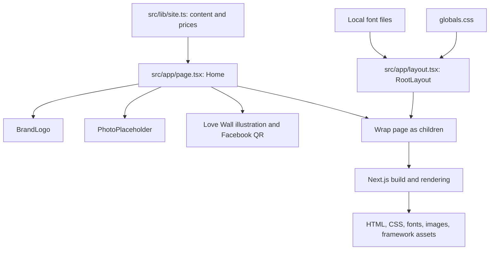

# Understanding Tio Philo: a guide for a Salesforce developer

This guide explains the website that is actually in this repository. You do not need to learn the entire JavaScript ecosystem before making useful changes here.

Start with this guide, keep the [file reference](FILE_REFERENCE.md) beside the code, and use the [editing playbook](EDITING_PLAYBOOK.md) when making a change.

For a first session, read sections 1-4 and trace one package price through the code. Then try the price-editing recipe. Use the remaining sections as a reference when you encounter unfamiliar syntax; you do not need to memorize the entire guide.

**Scope:** one public promotional page for an event coffee service. The site displays menu items, packages, phone links, a flyer, and photo placeholders. It has no database, Salesforce connection, authentication, payment processing, booking submission, or custom API endpoint. The booking buttons scroll to the contact section; they do not create bookings.

Examples identified as **teaching examples** are explanations, not features already installed in the site.

## 1. What each tool does

| Tool | Its job here | A useful Salesforce comparison | Where the comparison stops |
| --- | --- | --- | --- |
| JavaScript | The programming language underlying the application | The language you already use in LWC `.js` files | It also runs outside a Salesforce org |
| TypeScript | Adds type checking to JavaScript source | Some of the early error checking you get from Apex types | Types disappear from executable output; they do not validate incoming data at runtime |
| TSX / JSX | Lets components describe HTML-like UI inside code | LWC HTML templates plus expressions | JSX is JavaScript syntax transformed by the build tools, not an LWC template file |
| React | Builds UI from reusable components | LWC's component model | React uses different rendering, component, and state APIs |
| Next.js | Adds URL routing, rendering, image/font handling, and build/server commands around React | Parts of Experience Cloud's page framework and hosting responsibilities | It supplies no Salesforce org, CRM records, permissions, or platform services |
| Node.js | Runs JavaScript tools and the local Next.js server outside the browser | Think of having a server-side execution environment, as Apex has on the platform | You manage the runtime/process rather than receiving a complete managed Salesforce platform |
| npm | Installs packages and runs named project commands | Familiarity with CLI commands and package dependencies helps | It does not authenticate to or deploy into an org |
| CSS | Controls colors, spacing, layout, and responsive behavior | LWC component CSS and styling hooks | This project's global CSS is not automatically isolated like LWC styles |
| Tailwind CSS | Processes the Tailwind import and theme declarations | Design tokens may remind you of SLDS styling hooks | Tailwind does not provide Salesforce base components; this site mostly uses custom CSS classes |
| Turbopack | Builds modules and assets into browser/server output | A compiler/build pipeline that the platform usually handles for you | It is a build tool, not an application framework or hosting provider |
| ESLint | Finds certain code-quality and framework issues | A code analyzer | It is separate from TypeScript and is not an Apex test runner |

Node.js is a JavaScript runtime, rather than a UI framework. See the [official Node.js introduction](https://nodejs.org/learn/getting-started/introduction-to-nodejs) for that distinction.

### Versions observed in this workspace

Inspected on October 25, 2026. These are this project's versions, not a recommendation to upgrade to the newest release.

| Item | Observed version |
| --- | --- |
| Node.js | `24.22.1` |
| npm | `11.19.1` |
| Next.js | `16.4.3` |
| React and React DOM | `19.3.0` |
| TypeScript | `5.9.3` |
| Tailwind CSS | `4.3.3` |
| ESLint | `9.39.5` |

`package.json` declares dependencies; `package-lock.json` records the resolved dependency tree. A range such as `^5` is not the same thing as an installed exact version.

The project's [AGENTS.md](../AGENTS.md) specifically requires reading the installed Next.js documentation before changing framework APIs. The guides inside `node_modules/next/dist/docs/` match this installed release more closely than an arbitrary tutorial.

## 2. Where to start reading the code

Read these files in this order:

1. [site.ts](../src/lib/site.ts): business data, similar in purpose to a small collection of configuration records.
2. [page.tsx](../src/app/page.tsx): turns that data into the homepage.
3. [photo-placeholder.tsx](../src/components/photo-placeholder.tsx): a small reusable component with a clear conditional.
4. [brand-logo.tsx](../src/components/brand-logo.tsx): a component with an optional input.
5. [layout.tsx](../src/app/layout.tsx): wraps the page and configures fonts and metadata.
6. [globals.css](../src/app/globals.css): styles all those elements.
7. The remaining configuration files, using the [file reference](FILE_REFERENCE.md).

You can update menu items, prices, photos, and contact details without changing the framework configuration.

## 3. How data becomes a page



The arrows summarize dependencies and rendering; your code does not manually call `RootLayout(Home())`. Next.js recognizes the special filenames and composes them.

### Follow one price through the application

1. `site.ts` exports `{ cups: 50, price: 6000 }` as part of `packages`.
2. `page.tsx` imports `packages`.
3. `packages.map(...)` creates one table row per package.
4. `formatPrice(item.price)` receives the number `6000`.
5. `toLocaleString("en-PH")` adds locale-appropriate digit grouping.
6. The function prefixes the peso sign, producing `₱6,000`.
7. Next.js includes the result in the rendered page.

There is no SOQL query, Apex controller call, `@wire`, or DML operation in this sequence.

### Follow one photo through the application

1. `drinkPhotos` contains a photo configuration object.
2. `Home` passes the object into `<PhotoPlaceholder photo={photo} />`.
3. If `photo.src` is `null`, the component renders a camera symbol and placeholder text.
4. If `photo.src` is a nonempty path, it renders Next.js's `<Image>` instead.
5. CSS determines the frame's size and crops the displayed image to fit.

A nonempty but incorrect path still selects the image branch. The component does not catch a missing file and automatically switch back to the placeholder.

## 4. Development, build, and serving are different steps

Salesforce often combines saving source, compiling it, and making it available inside an org. Here the steps are explicit.

| Command | What happens | When to use it |
| --- | --- | --- |
| `npm install` | Downloads dependencies and prepares `node_modules`; may update the lockfile | Initial setup or intentional dependency changes |
| `npm ci` | Recreates dependencies from the lockfile and requires it to match `package.json`; replaces existing `node_modules` | A reproducible clean install, especially in automation |
| `npm run dev` | Runs `next dev`, watches source changes, and serves a development preview | Normal editing |
| `npm run build` | Runs `next build`, compiles assets, checks TypeScript, and generates production output in `.next` | Before releasing code |
| `npm start` | Runs `next start` to serve an existing production build | Checking production behavior after building |
| `npm run lint` | Runs the configured ESLint analyzer | Checking style/framework rules separately |

The command names are defined in [package.json](../package.json). `npm start` is a supported shorthand for the `start` script; `npm run dev` runs the script named `dev`. See npm's [package.json documentation](https://docs.npmjs.com/cli/v11/configuring-npm/package-json/) for the scripts and dependency fields.

In Windows PowerShell, `npm.cmd` can be used in place of `npm` when the shell blocks the `npm.ps1` wrapper. For example: `npm.cmd run dev`.

### What the build currently generates

The last verified website build marked `/` as a statically prerendered route. The page's content can be generated in advance because its inputs are local constants.

The normal production command is `next start`, and Next.js image optimization can involve server work when real photos are displayed. A separate GitHub Pages profile is now available: `npm run build:pages` sets `GITHUB_PAGES=true`, generates a static `out/` directory, and disables features requiring the Next.js server. See the [deployment guide](DEPLOYMENT.md) for the distinction and automatic publishing workflow.

Changing `site.ts` during development updates the preview. Changing source after a production build does not refresh that already-built output: rebuild and restart/redeploy to publish the change.

`localhost:3000` means the machine where the server runs. Starting it does not publish the site to the internet, commit code to Git, or create a Salesforce deployment.

## 5. TypeScript syntax through an Apex lens

### Type annotations

Actual code:

```ts
function formatPrice(amount: number) {
  return `₱${amount.toLocaleString("en-PH")}`;
}
```

- `function` declares a function.
- `amount` is the parameter name.
- `: number` says the parameter must be a number when TypeScript checks callers.
- `return` sends the result back to the caller.
- The return type is inferred as `string`; an explicit `: string` would also be valid.

Apex-style teaching equivalent:

```apex
public static String formatPrice(Decimal amount) {
    // Return a formatted display string.
    // This comment omits locale formatting to focus on the signature.
    return 'PHP ' + String.valueOf(amount);
}
```

The analogy is the typed input and returned value, not identical currency-formatting behavior. JavaScript `number` is a floating-point numeric type; it is not Apex `Decimal`. The site's stored prices are whole-peso numbers.

### Object shapes versus classes

Actual type:

```ts
export type DrinkPhoto = {
  label: string;
  alt: string;
  src: string | null;
};
```

Apex-style teaching equivalent:

```apex
public class DrinkPhotoDTO {
    @AuraEnabled public String label { get; set; }
    @AuraEnabled public String alt { get; set; }
    @AuraEnabled public String src { get; set; }
}
```

The TypeScript `type` describes a permitted object shape. It is not a constructor, database schema, or record type, and you do not write `new DrinkPhoto()`.

`string | null` is a **union**: the field can contain a string or `null`. With this project's strict checking, `src: 123` is invalid. TypeScript checks your source; it does not automatically validate a value received from a future public API. The [TypeScript everyday types guide](https://www.typescriptlang.org/docs/handbook/2/everyday-types.html) explains annotations, object types, and unions.

### Objects, arrays, and inference

```ts
const packageOption = { cups: 50, price: 6000 };
const packageOptions = [packageOption];
```

Think of an object as one bundle of named fields and an array as an ordered collection, somewhat like a DTO and a `List<DTO>` in Apex. They are not automatically sObjects.

TypeScript infers that `cups` and `price` are numbers. You do not have to annotate every variable.

`const` prevents reassignment of the variable. It does not freeze an object or its array contents. This site uses module-level constants as configuration and does not modify them in event handlers.

### Imports and exports

```ts
export const packages = [
  { cups: 50, price: 6000 },
];
```

```ts
import { packages } from "@/lib/site";
```

`export` makes a module member available to other modules; `import` brings it into another file. This is JavaScript module organization, not Apex access control.

- `import { BrandLogo } ...` imports a named export, so the name must match unless explicitly aliased.
- `export default function Home()` gives the module one default export. A default import does not use braces.
- `import type { DrinkPhoto } ...` imports a type for checking; it is removed from the runtime code.
- `import "./globals.css"` loads styling without importing a JavaScript value.
- `@/lib/site` maps to `src/lib/site` because `tsconfig.json` defines that alias. It is not an npm package named `@` or a Salesforce namespace.

### Different braces mean different things

| Example | Meaning |
| --- | --- |
| `const item = { cups: 50 }` | Object literal |
| `function Arrow() { ... }` | Function body |
| `import { site } from "..."` | Named import |
| `<h3>{group.category}</h3>` | Evaluate a JavaScript expression inside JSX |
| `function BrandLogo({ large = false })` | Extract a property from the argument object |
| `` `₱${amount}` `` | Substitute a value into a template string |

Backticks create template strings. Single or double quotes create ordinary strings. The code uses each intentionally.

## 6. React components through an LWC lens

React's [component introduction](https://react.dev/learn/your-first-component) describes the component model. In this repository, a component is a function returning JSX.

### A component returns a UI description

Actual code:

```tsx
function Arrow() {
  return <span aria-hidden="true">↗</span>;
}
```

`<Arrow />` inserts that description wherever it is used. It is like reusing a tiny LWC, although it does not require a separate LWC bundle, class, or metadata file.

Use uppercase names for React components. `<BrandLogo />` refers to your function; lowercase `<span>` refers to a built-in HTML element.

TSX allows markup in a TypeScript file. Unlike a string such as `"<span>hello</span>"`, JSX produces a UI description that React understands.

### Properties: `props` versus `@api`

Actual signature:

```tsx
export function BrandLogo({ large = false }: { large?: boolean }) {
  // Returns the logo JSX.
}
```

Read it in pieces:

1. `BrandLogo` is the function/component name.
2. The function receives one object containing its inputs, called props.
3. `{ large = false }` extracts the `large` input and supplies a default.
4. `{ large?: boolean }` describes that props object's type.
5. `?` makes the property optional.

Usage:

```tsx
<BrandLogo />
<BrandLogo large />
<BrandLogo large={true} />
```

The first uses `false`; the last two pass `true`. `large="false"` passes a string and is not equivalent to `large={false}`.

LWC teaching comparison:

```js
import { LightningElement, api } from 'lwc';

export default class BrandLogo extends LightningElement {
    @api large = false;
}
```

Both express a parent supplying an input to a child. React props should be treated as read-only by the child. There is no `@api` decorator in this React component.

### Repeating markup: `.map()` versus `for:each`

Actual pattern:

```tsx
{flavors.map((group) => (
  <div className="flavor-group" key={group.category}>
    <h3>{group.category}</h3>
  </div>
))}
```

`.map()` calls a function once per array element and returns a new array of results. Here those results are React elements. It is not SOQL or a server request.

`(group) => (...)` is an **arrow function**. The expression inside `(...)` is returned automatically. If you change its body to `{ ... }`, you need an explicit `return`.

LWC teaching comparison:

```html
<template for:each={flavors} for:item="group">
    <div key={group.category}>
        <h3>{group.category}</h3>
    </div>
</template>
```

Both identify repeated items using keys. A React `key` must be stable and unique among siblings; it is not passed to the component as a normal prop. The current code uses category, flavor name, photo label, cup count, add-on name, or phone URL as keys. Keep those values unique within their respective lists. Salesforce's [list-rendering guide](https://developer.salesforce.com/docs/platform/lwc/guide/create-lists.html) provides the LWC side of this comparison.

### Conditional markup

Actual pattern, shortened to show the decision:

```tsx
{site.facebookUrl ? (
  <a href={site.facebookUrl}>Message us on Facebook</a>
) : (
  <p>You can also message our Facebook page.</p>
)}
```

The ternary operator means `condition ? resultIfTrue : resultIfFalse`. An empty string is falsy and would display text instead of a link. The current Facebook URL is populated, so the page renders the link.

LWC teaching equivalent:

```html
<template lwc:if={facebookUrl}>
    <a href={facebookUrl}>Message us on Facebook</a>
</template>
<template lwc:else>
    <p>You can also message our Facebook page.</p>
</template>
```

Use modern conditional directives for the comparison; see Salesforce's [conditional-rendering documentation](https://developer.salesforce.com/docs/platform/lwc/guide/create-conditional.html).

### Other JSX differences

| Code | Meaning |
| --- | --- |
| `className="button"` | Assign CSS classes; JSX uses `className` rather than HTML's `class` |
| `<><header /> <main /></>` | A Fragment: groups siblings without adding another HTML wrapper |
| `<PhotoPlaceholder photo={photo} />` | Pass the object value, not the literal text `photo` |
| `<br />`, `<Image ... />` | Self-closing JSX tags |
| `aria-hidden="true"` | Hide purely decorative output from accessibility APIs |
| `{/* explanation */}` | Comment inside JSX; ordinary JavaScript outside JSX can use `//` |

## 7. Server code and browser code

The authored page, layout, and components have no `"use client"` directive. They use Next.js's Server Component model. For this static page, much of their work occurs during the production build.

The browser still receives framework assets, and framework components such as `next/image` can have client behavior. Server Components do not mean the final site contains zero JavaScript.

| Behavior | Where it happens in this site |
| --- | --- |
| Read `packages`, format prices, choose a photo branch | Next.js rendering/build environment |
| Apply CSS and responsive rules | Browser |
| Scroll to `#packages` or `#contact` | Browser's built-in anchor navigation |
| Open a `tel:` link | Browser/device's supported phone handler |
| Load images and fonts | Browser requests generated or public assets |
| Record a booking | Not implemented |

For an interactive counter, filter, or expandable menu, create a small Client Component using `"use client"`, React state, and event handlers. Do not add the directive to `layout.tsx` just to handle one button; metadata exports belong on the server side.

The installed [Server and Client Components guide](../node_modules/next/dist/docs/01-app/01-getting-started/05-server-and-client-components.md) explains this boundary. It is related to the LWC/Apex separation in purpose, but there is no automatic Apex call or `@wire` equivalent created by a React prop.

## 8. HTML, CSS, and assets

### Public paths are URLs, not Windows paths

```text
File on disk: public/brand/tio-philo-flyer.png
URL in code:  /brand/tio-philo-flyer.png
```

Do not put `C:\Users\USER\Downloads\...` or `/public/...` into an image URL. Someone else's browser cannot read your Downloads folder. Think of `public/` as a simple public static-resource directory, with different URL conventions from Salesforce Static Resources.

Everything intentionally placed in `public/` is publicly addressable when the site is hosted, including files that are not linked from the homepage.

### CSS classes are shared

`className="hero wrap"` applies two selectors: `.hero` supplies section layout and `.wrap` supplies centered width. There is no special Next.js feature called `wrap`; it is just a class defined by this project.

Most styling is ordinary CSS, even though Tailwind is installed. The global stylesheet can affect every route. Class names are not scoped automatically to a component or protected by LWC's style encapsulation.

CSS custom properties such as `--background` work like reusable design tokens. `var(--background)` reads the value. `@theme inline` connects values to Tailwind's theme system.

### Layout vocabulary

| CSS | Plain-English meaning |
| --- | --- |
| `display: grid` | Arrange content in rows/columns |
| `grid-template-columns: 1fr 1fr` | Two equally sized flexible columns |
| `display: flex` | Arrange items along a main direction |
| `gap` | Space between children |
| `padding` / `margin` | Space inside / outside an element |
| `max-width` | Limit how wide content can become |
| `aspect-ratio` | Reserve a consistent width-to-height shape |
| `object-fit: cover` | Fill an image frame, allowing visual cropping |
| `clamp(min, preferred, max)` | Let a size grow within limits |
| `@media (max-width: 700px)` | Override styles when the viewport is 700 CSS pixels wide or narrower |

The image file is not changed by CSS cropping. This matters for the uploaded logo: `BrandLogo` frames the existing image rather than generating a new one.

## 9. What to say when explaining this build

You can describe it this way:

> This is a Next.js website built with React and TypeScript. Business content is stored in a local TypeScript module. React components turn that content into a page, and CSS provides the brand styling and mobile layout. Node.js runs our development tools and server. npm installs dependencies and runs the development and production commands. The current homepage is generated in advance during the build. Customers can see packages and contact the business, but the website does not submit bookings or store records.

Then demonstrate one change:

1. Open `src/lib/site.ts`.
2. Change one package's numeric price.
3. Show the updated table in the development preview.
4. Explain that a production deployment requires a new build.

Useful self-check questions:

- Can you explain why editing `.next` would be temporary?
- Can you trace a package from `site.ts` into a rendered table row?
- Can you explain why `null` shows a photo placeholder?
- Can you distinguish a component prop from a database field?
- Can you explain why a successful build is different from a successful booking submission?

Continue with the [file reference](FILE_REFERENCE.md) for every file and function, or the [editing playbook](EDITING_PLAYBOOK.md) for hands-on exercises.

## 10. Small glossary for conversations outside Salesforce

| Term | Plain-English meaning in this project |
| --- | --- |
| Runtime | The environment executing code, such as Node.js or the browser |
| Framework | Code and conventions that organize an application; Next.js is the framework here |
| Module | A source file that imports/exports code or values |
| Package | A distributed dependency installed through npm; it can contain many modules |
| Dependency | Another package this project relies on |
| Component | A reusable UI description, usually a function returning JSX here |
| Prop | A value supplied by a parent component to a child |
| DOM | Document Object Model: the browser's representation of page elements |
| Build | Turn source, types, styles, and assets into production output |
| Bundle | A generated grouping of code/assets prepared for delivery or execution |
| Prerender | Generate page output before the visitor's request |
| Hydration | Attach React's client behavior to already-rendered HTML where Client Components require it |
| Route | A URL handled by the application, such as `/`; `#contact` is an anchor within that URL |
| Endpoint | A URL handling a request/response operation, often an API; this site has no custom API endpoint |
| HTTP 200 / 404 | The server returned a successful response / could not find the requested resource |
| Deployment | Put a built application onto a hosting environment where the intended audience can reach it |

These terms describe separate responsibilities. Installing packages is not deploying, a type is not a database schema, and changing a component's appearance does not create backend behavior.
